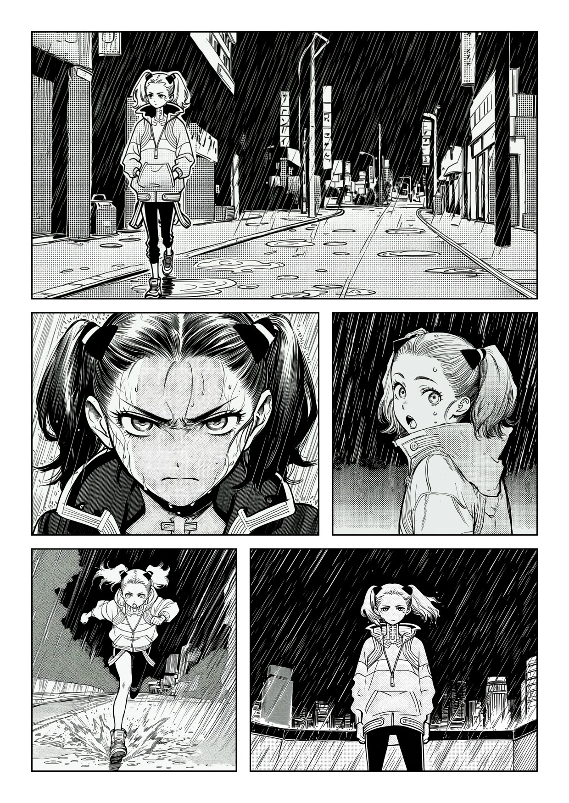

# ComfyUI Anima Komikku

Manga and comic pages with [Anima](https://huggingface.co/circlestone-labs/Anima): design the page, write one Anima prompt per panel, render every panel with one sampler chain and letter the page.

The nodes only handle the page. Character identity and the global art style are ordinary model patches in the workflow:

- **Character identity**: [SnapRef](https://huggingface.co/0ppxnhximxr/snapref-v2a-pre2) or the [Anima Reference Adapter](https://huggingface.co/ElectronGirl/anima-ref-adapter) ([nodes](https://github.com/ElectronGirl/ComfyUI-Anima-Ref-Adapter)).
- **Global style**: [Anima Artist Mixer](https://github.com/An1X3R/Anima-Artist-Mixer), or artist tags in the `style` input.

## Nodes

**Anima Komikku Page & Panels**: page layout editor (templates, free-form polygons, knife cuts, panel order, import of an existing page). Outputs one prompt per panel (`quality, style, panel prompt`) and one size per panel as lists, plus the layout. Wire the prompt list to the text encoder (or `base_prompt` of Anima Artist Pack) and the sizes to an empty latent: ComfyUI runs the sampler once per panel.

**Anima Komikku Page Compose**: places the panel images on the page in panel order, with per-panel framing, RGB/RGBA overlays and lettering (speech, thought, shout, whisper, captions, SFX) edited in the page editor.

Both editors can rewrite panel prompts and dialogue with a text model wired to `assist_clip` (e.g. the MOSS-Image Qwen3.5-9B encoder). Overlays, fonts and the starred library are shared with Minimax-H3-Komikku (`input/komikku`, `user/<user>/komikku_fonts`, `user/<user>/komikku_library`).

## Workflow

`example_workflows/Anima-Komikku.json`:

1. Anima model, Qwen3 0.6B text encoder, Qwen-Image VAE. The example uses an Anima manga finetune; any Anima model works.
2. Character reference: **SnapRef** (mode *Character*), or **Anima Ref Adapter** (bypassed by default; Ctrl+B to swap). Pick your character picture in both Character reference and SnapRef. The Ref Adapter keeps the character closer but also brings the reference's drawing style; SnapRef in *Character* mode leaves the style to the model and the artists and is faster.
3. Page & Panels → Anima Artist Pack → Anima Artist Adapter Mixer → KSampler (er_sde, 30 steps, cfg 4.5) → VAE Decode → Page Compose.

With an empty `artist_chain` the Artist Pack only encodes the prompt, so the same chain works with artist tags written in `style` instead.

Panel prompts are Danbooru tags: people count, framing, then pose, place and light. Do not name the character or describe hair and outfit; the reference does that. For two characters, stitch both pictures side by side and say who is on the left and right.

## License

MIT. Adapter weights keep their own licenses.
